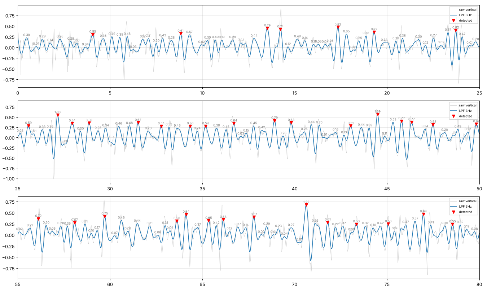

# PDR 튜닝 기록

> 1차 튜닝 이후 변경 이력과 판단 근거를 한곳에 정리한 문서: [`pdr_improvement_log.md`](pdr_improvement_log.md)

튜닝할 때마다 `scripts/tune_pdr.py --save ...` 가 아래에 기록을 추가한다. 각 기록의 '분석·메모'는 직접 채운다.

## 공통 규칙
- **tune 세션으로만 값을 고르고, eval 세션은 확인용으로만 쓴다.** eval 결과를 보고 값을 다시 고치면 그 세션은 더 이상 평가용이 아니다.
- 오차는 모두 `(추정 − 정답) / 정답` 의 절댓값 평균. 걸음 수 정답은 직접 센 값, 거리 정답은 타일 수 × 0.6 m.
- 한 번에 바꾼 파라미터가 여러 개면, 하나씩 되돌려 본 결과(기여도)를 분석·메모에 남긴다.

---

## 2026-10-16 18:23 — `pdr_tuned_v1.toml` 1차 튜닝 (첫 측정 10세션)

- 기준 설정: `pdr_default.toml`
- tune 세션 (4): 20261011_S1_normal_01, 20261011_L1_normal_01, 20261011_S1_slow_02, 20261011_S1_fast_02
- eval 세션 (6): 20261011_S2_normal_01, 20261011_T2_normal_01, 20261011_S1_slow_01, 20261011_L1_slow_01, 20261011_S1_fast_01, 20261011_S1_slow_03

### 탐색 방법
1. 걸음 검출: 아래 격자 135개 조합을 tune 세션에 돌려 **걸음 수 평균 절대 오차 비율**이 가장 작은 조합 선택
- `step.min_height`: [0.15, 0.2, 0.3, 0.4, 0.5]
- `step.min_prominence`: [0.2, 0.3, 0.5]
- `preprocess.lpf_cutoff_hz`: [2.0, 2.5, 3.0]
- `step.min_interval_s`: [0.3, 0.4, 0.5]
2. 보폭: Weinberg 지수 후보 0.15~1.0 각각에 대해 K를 최소제곱으로 구하고, tune **거리 평균 절대 오차**가 가장 작은 지수 선택

### 바뀐 파라미터
| 파라미터 | 기준 | 튜닝 |
|---|---|---|
| `step.min_height` | 0.5 | 0.15 |
| `step.min_interval_s` | 0.3 | 0.5 |
| `length.k` | 0.48 | 0.3317 |
| `length.exponent` | 0.25 | 0.7 |

### 걸음 검출 상위 5개 조합
| step.min_height | step.min_prominence | preprocess.lpf_cutoff_hz | step.min_interval_s | step_err_pct |
|---|---|---|---|---|
| 0.15 | 0.50 | 3.00 | 0.50 | 2.33 |
| 0.20 | 0.50 | 3.00 | 0.50 | 2.33 |
| 0.30 | 0.20 | 3.00 | 0.40 | 4.55 |
| 0.30 | 0.30 | 3.00 | 0.40 | 4.55 |
| 0.30 | 0.50 | 3.00 | 0.40 | 4.57 |

### 결과 요약
| 지표 (평균 절대 오차) | 기준 설정 | 튜닝 결과 |
|---|---|---|
| 걸음 수 % (tune) | 28.40 | 2.30 |
| 걸음 수 % (eval) | 49.60 | 3.60 |
| 거리 % (tune) | 24.70 | 6.90 |
| 거리 % (eval) | 46.10 | 8.20 |
| 폐루프 종점 % (eval) | 4.60 | 1.90 |

### 세션별
| session_id | split | steps_gt | steps_est_기준 | dist_gt | dist_est_기준 | steps_est_튜닝 | dist_est_튜닝 | end_err_m |
|---|---|---|---|---|---|---|---|---|
| 20261011_S1_normal_01 | tune | 27 | 31 | 16.20 | 18.23 | 28 | 17.09 |  |
| 20261011_L1_normal_01 | tune | 115 | 127 | 67.20 | 72.50 | 116 | 66.02 | 1.12 |
| 20261011_S1_slow_02 | tune | 63 | 10 | 16.20 | 4.90 | 60 | 16.65 |  |
| 20261011_S1_fast_02 | tune | 23 | 22 | 16.20 | 14.80 | 23 | 19.07 |  |
| 20261011_S2_normal_01 | eval | 53 | 59 | 32.40 | 35.14 | 55 | 34.66 | 0.58 |
| 20261011_T2_normal_01 | eval | 116 | 143 | 66.00 | 83.03 | 118 | 73.43 | 1.03 |
| 20261011_S1_slow_01 | eval | 51 | 9 | 16.20 | 4.48 | 54 | 15.74 |  |
| 20261011_L1_slow_01 | eval | 203 | 25 | 67.20 | 12.65 | 203 | 58.41 | 1.66 |
| 20261011_S1_fast_01 | eval | 24 | 24 | 16.20 | 15.52 | 24 | 18.44 |  |
| 20261011_S1_slow_03 | eval | 69 | 5 | 16.20 | 2.47 | 62 | 16.42 |  |

### 분석·메모

**각 변경의 기여도** (튜닝 결과에서 하나만 기본값으로 되돌렸을 때, 평균 절대 오차 %)

| 설정 | 걸음 tune | 걸음 eval | 거리 tune | 거리 eval |
|---|---|---|---|---|
| 기본값 | 28.4 | 49.6 | 24.7 | 46.1 |
| **1차 튜닝** | **2.3** | **3.6** | **6.9** | **8.2** |
| min_height만 0.5로 되돌림 | 23.9 | 44.3 | 25.4 | 47.3 |
| min_interval_s만 0.30으로 되돌림 | 17.0 | 16.3 | 19.5 | 16.3 |
| 보폭 지수·K만 0.25 / 0.48로 되돌림 | 2.3 | 3.6 | 18.8 | 28.7 |
| min_height = 0 (높이 조건 제거) | 2.3 | 3.6 | 6.9 | 8.2 |

- **min_height 0.5 → 0.15:** 느린 걸음 봉우리 높이가 0.3~0.5 m/s² 라 기본값에서 거의 다 버려졌다. 낮추자 느린 걸음이 잡히기 시작했다. 0으로 해도 결과가 같아서, 이제 걸음 판단은 사실상 `min_prominence`(0.5)와 `min_interval_s`가 하고 있다.
- **min_interval_s 0.30 → 0.50:** 보통 걸음에서 한 걸음에 봉우리가 두 개씩 생겨 10% 정도 더 세던 문제(27 → 31보)를 줄였다. 이번 데이터에서 가장 빠른 걸음이 약 1.6~1.8보/s(간격 0.56~0.63 s)라 0.5는 **한계에 가깝다**. 더 빨리 걷는 사람에게는 걸음을 합쳐버릴 위험이 있다.
- **Weinberg 지수 0.25 → 0.7, K 0.48 → 0.33:** 교과서 값(0.25)은 출렁임 크기가 작아져도 보폭을 거의 줄이지 않아, 느린 걸음(실제 보폭 약 0.25~0.3 m)을 0.4 m 이상으로 계산했다. 지수를 키우자 느린 걸음 거리 오차가 +33~46% → ±3% 수준이 됐다. 0.25는 손에 든 폰·허리 장착 연구에서 나온 값이라, 가슴(가로) 장착에서는 다를 수 있다.

**남은 문제**
- 빠른 걸음 거리 +14~18%, 느린 폐루프 거리 −13%. 같은 K로 양 끝 속도를 다 맞추지 못한다 → 걸음 빈도를 함께 쓰는 보폭 모델 비교 필요.
- 느린 폐루프(L1_slow_01)는 걸음 수는 정확(203)한데 거리가 짧다 → 긴 녹화에서 출렁임 크기가 작아지는 구간이 있는지 확인 필요.
- 매우 느림(S1_slow_03) 걸음 수 −10% (69 → 62).

**신뢰도**
- tune 세션 4개, 측정자 1명, 대부분 경로별 1회 측정 → 과적합 가능성이 크다. 반복 측정을 추가한 뒤 2차 튜닝에서 이 값들이 유지되는지 확인한다.
- 걸음 검출 1·2위 조합의 오차가 같다(2.33%). 탐색 격자가 데이터 4개로는 값을 하나로 좁히지 못한다는 뜻이다.

---

## 2026-10-16 20:30 — 추가 분석 (파라미터 변경 없음)

`pdr_tuned_v1.toml` 기준으로 새 데이터 없이 확인한 것.

| 설정 | 걸음 eval % | 거리 eval % | 폐루프 종점 % | 회전 오차 ° |
|---|---|---|---|---|
| 1차 튜닝 (오프라인 필터) | 3.6 | 8.2 | 1.9 | 4.0 |
| 실시간 필터 (`preprocess.causal = true`) | 7.2 | 13.2 | 2.7 | 4.0 |
| 헤딩을 iPhone yaw로 (`heading.source = "orientation"`) | 3.6 | 8.2 | 23.9 | 31.8 |
| 걸음 구간 평균 헤딩 끔 (`heading.step_average = false`) | 3.6 | 8.2 | 1.6 | 4.0 |

- **실시간 필터로 바꾸면 오차가 약 2배.** 오프라인 필터는 앞뒤 데이터를 다 보고 다듬지만, 실시간 필터는 과거 데이터만 써서 파형이 늦고 찌그러진다. iOS 포팅 전에 (1) causal 기준으로 다시 튜닝하거나 (2) 0.5초 정도 지연을 허용하고 짧은 구간 단위로 오프라인 필터를 적용하는 방식 중 하나를 골라야 한다. 1초 지연 요구사항 안에서는 (2)도 가능하다.
- **iPhone yaw는 헤딩으로 쓰면 안 된다.** 폐루프 회전량이 305°(정답 270°), L자 왕복이 148°(정답 180°)로 크게 틀린다. Sensor Logger의 Orientation이 자력계 기준으로 계산된 것으로 보이며, 실내 자기 교란 영향을 받는다. 자이로 직접 적분은 3~6° 이내. 자이로 기반을 쓰는 근거.
- 걸음 구간 평균 헤딩은 효과가 거의 없다(종점 1.9 → 1.6%로 끄는 쪽이 오히려 약간 나음). 데이터가 늘면 다시 비교.

### 교차검증 (leave-one-out): 보폭 지수가 얼마나 안정적인가
세션 10개 중 1개를 빼고 나머지 9개로 지수·K를 맞춘 뒤, 빼둔 1개의 거리 오차를 보는 것을 10번 반복 (걸음 검출 설정은 v1 고정).

| 빼둔 세션 | 지수 | K | 거리 오차 % |
|---|---|---|---|
| S1_normal_01 | 0.55 | 0.359 | −0.1 |
| S2_normal_01 | 0.55 | 0.359 | +0.8 |
| T2_normal_01 | 0.50 | 0.373 | +4.1 |
| L1_normal_01 | 0.60 | 0.344 | −5.8 |
| S1_slow_01 | 0.55 | 0.360 | +8.1 |
| L1_slow_01 | 0.65 | 0.328 | −13.3 |
| S1_fast_01 | 0.65 | 0.340 | +9.7 |
| S1_slow_02 | 0.55 | 0.360 | +15.7 |
| S1_slow_03 | 0.50 | 0.370 | +20.2 |
| S1_fast_02 | 0.65 | 0.340 | +12.9 |

- 평균 절대 거리 오차 **9.1%**. 처음 보는 세션에 대한 현실적인 예상 오차로 보는 게 맞다.
- 지수는 0.50~0.65 사이에서 움직인다. v1의 0.7은 tune 4개 세션에 맞춰진 값이고, 전체로 보면 **0.55 근처**가 더 안정적일 가능성이 있다.
- 세션이 적을 때는 tune/eval 고정 분할보다 이 방식이 데이터를 덜 버린다. 2차 튜닝부터 교차검증을 기본으로 쓰는 것을 검토.

---

## 2026-10-16 20:37 — `pdr_tuned_v2.toml` 첫 측정 10세션, 교차검증 방식, 보폭 모델 weinberg 고정

- 방식: `cv`  기준 설정: `pdr_default.toml`
- 세션 (10): 20261011_S1_normal_01, 20261011_S2_normal_01, 20261011_T2_normal_01, 20261011_L1_normal_01, 20261011_S1_slow_01, 20261011_L1_slow_01, 20261011_S1_fast_01, 20261011_S1_slow_02, 20261011_S1_slow_03, 20261011_S1_fast_02
- 걸음 검출 탐색 격자: `step.min_height` [0.15, 0.2, 0.3, 0.4, 0.5]; `step.min_prominence` [0.2, 0.3, 0.5]; `preprocess.lpf_cutoff_hz` [2.0, 2.5, 3.0]; `step.min_interval_s` [0.3, 0.4, 0.5]
- 보폭 지수 후보: 0.15~1.0 (0.05 간격), 모델 후보: weinberg, weinberg_freq

### 교차검증 결과 (빼둔 세션 기준)
| model | 걸음 수 오차 % | 거리 오차 % | 거리 오차 최대 % | 지수 범위 | K 범위 |
|---|---|---|---|---|---|
| weinberg | 3.10 | 9.10 | 20.20 | 0.50~0.65 | 0.328~0.373 |
| weinberg_freq | 3.10 | 7.90 | 13.70 | 0.15~0.15 | 0.947~1.816 |

선택한 보폭 모델: **weinberg**

### 반복별로 골라진 값 (값이 많이 흔들리면 데이터 부족)
| 빼둔 세션 | min_height | min_prominence | lpf_cutoff_hz | min_interval_s | exponent | k | k_freq | offset_m | steps_gt | steps_est | step_err_pct | dist_err_pct |
|---|---|---|---|---|---|---|---|---|---|---|---|---|
| 20261011_S1_normal_01 | 0.15 | 0.50 | 3.00 | 0.50 | 0.55 | 0.36 | 0.00 | 0.00 | 27 | 28 | 3.70 | -0.14 |
| 20261011_S2_normal_01 | 0.15 | 0.50 | 3.00 | 0.50 | 0.55 | 0.36 | 0.00 | 0.00 | 53 | 55 | 3.77 | 0.81 |
| 20261011_T2_normal_01 | 0.15 | 0.50 | 3.00 | 0.50 | 0.50 | 0.37 | 0.00 | 0.00 | 116 | 118 | 1.72 | 4.13 |
| 20261011_L1_normal_01 | 0.15 | 0.50 | 3.00 | 0.50 | 0.60 | 0.34 | 0.00 | 0.00 | 115 | 116 | 0.87 | -5.80 |
| 20261011_S1_slow_01 | 0.15 | 0.50 | 3.00 | 0.50 | 0.55 | 0.36 | 0.00 | 0.00 | 51 | 54 | 5.88 | 8.08 |
| 20261011_L1_slow_01 | 0.15 | 0.50 | 3.00 | 0.50 | 0.65 | 0.33 | 0.00 | 0.00 | 203 | 203 | 0.00 | -13.35 |
| 20261011_S1_fast_01 | 0.15 | 0.50 | 3.00 | 0.50 | 0.65 | 0.34 | 0.00 | 0.00 | 24 | 24 | 0.00 | 9.74 |
| 20261011_S1_slow_02 | 0.15 | 0.50 | 3.00 | 0.50 | 0.55 | 0.36 | 0.00 | 0.00 | 63 | 60 | -4.76 | 15.68 |
| 20261011_S1_slow_03 | 0.15 | 0.50 | 3.00 | 0.50 | 0.50 | 0.37 | 0.00 | 0.00 | 69 | 62 | -10.14 | 20.23 |
| 20261011_S1_fast_02 | 0.15 | 0.50 | 3.00 | 0.50 | 0.65 | 0.34 | 0.00 | 0.00 | 23 | 23 | 0.00 | 12.90 |

### 최종 선택 (전체 학습 데이터로 다시 고른 값)
| 파라미터 | 기준 | 튜닝 |
|---|---|---|
| `step.min_height` | 0.5 | 0.15 |
| `step.min_interval_s` | 0.3 | 0.5 |
| `length.k` | 0.48 | 0.3591 |
| `length.exponent` | 0.25 | 0.55 |

### 세션별 (최종 설정)
| session_id | split | steps_gt | steps_est_기준 | dist_gt | dist_est_기준 | steps_est_튜닝 | dist_est_튜닝 | end_err_m | turn_est |
|---|---|---|---|---|---|---|---|---|---|
| 20261011_S1_normal_01 | tune | 27 | 31 | 16.20 | 18.23 | 28 | 16.18 |  | 5.84 |
| 20261011_S2_normal_01 | eval | 53 | 59 | 32.40 | 35.14 | 55 | 32.64 | 0.54 | 183.13 |
| 20261011_T2_normal_01 | eval | 116 | 143 | 66.00 | 83.03 | 118 | 69.31 | 0.93 | 183.09 |
| 20261011_L1_normal_01 | tune | 115 | 127 | 67.20 | 72.50 | 116 | 63.58 | 0.69 | 275.07 |
| 20261011_S1_slow_01 | eval | 51 | 9 | 16.20 | 4.48 | 54 | 17.48 |  | 6.53 |
| 20261011_L1_slow_01 | eval | 203 | 25 | 67.20 | 12.65 | 203 | 65.02 | 1.59 | 276.45 |
| 20261011_S1_fast_01 | eval | 24 | 24 | 16.20 | 15.52 | 24 | 16.65 |  | 0.01 |
| 20261011_S1_slow_02 | tune | 63 | 10 | 16.20 | 4.90 | 60 | 18.68 |  | 3.86 |
| 20261011_S1_slow_03 | eval | 69 | 5 | 16.20 | 2.47 | 62 | 18.62 |  | 1.14 |
| 20261011_S1_fast_02 | tune | 23 | 22 | 16.20 | 14.80 | 23 | 16.91 |  | 4.80 |

### 분석·메모

**바뀐 점 (v1 → v2):** 걸음 검출 설정은 그대로이고, 보폭 지수 0.7 → 0.55, K 0.33 → 0.36. v1은 tune 4개로 고른 값, v2는 10개 전부로 고른 값이다. 교차검증에서 지수가 0.50~0.65 사이로 나와서 0.55가 더 안정적인 값으로 보인다.

**교차검증 오차가 v1의 eval 오차(8.2%)보다 큰 이유:** 숫자가 나빠진 게 아니라 재는 방식이 달라졌다. v1의 8.2%는 eval 6개에 대한 값이고, 교차검증 9.1%는 10개 세션을 하나씩 처음 보는 데이터로 놓고 잰 값이다. 매우 느린 걸음(+20%)처럼 어려운 세션이 빠짐없이 들어가서 더 현실적인 예상치다.

**걸음 빈도 보폭 모델 (`weinberg_freq`): 채택 보류**
- 교차검증 거리 오차는 더 낮다 (9.1% → 7.9%, 최대 20.2% → 13.7%).
- 하지만 골라진 값이 물리적으로 말이 안 된다. 지수가 매번 탐색 범위 하한(0.15)에 붙고, 상수항이 −1.0 m, K가 반복마다 0.95~1.82로 흔들리며, 한 반복에서는 걸음 빈도 계수가 음수(빨리 걸을수록 보폭이 짧아짐)다.
- 세션 9~10개로 숫자 3개를 맞추다 보니 의미 없이 숫자만 맞춰진 상태로 판단. 반복 측정으로 세션이 20개 이상 되면 다시 비교한다. 옵션은 코드에 남겨둠 (`length.model = "weinberg_freq"`).

**앱 방식 필터 (`preprocess.mode = "delayed"`) 확인** — v1 설정 기준 eval 평균 절대 오차

| 필터 방식 | 걸음 % | 거리 % | 폐루프 종점 % |
|---|---|---|---|
| 오프라인 (분석용) | 3.6 | 8.2 | 1.9 |
| 실시간 단방향 (causal) | 7.2 | 13.2 | 2.7 |
| **0.5초 지연 (delayed, 채택)** | 3.7 | 8.4 | 2.1 |
| 0.3초 지연 | 3.7 | 8.0 | 1.8 |
| 1.0초 지연 | 3.6 | 8.2 | 1.9 |

- 0.5초 지연 방식은 오프라인과 사실상 같다. 앱에서는 이 방식을 쓴다 (2026-10-16 결정). 0.3초도 차이가 없어서, 나중에 지연을 더 줄일 여지가 있다.
- 튜닝·분석은 계속 오프라인으로 하고, 앱 이식 전 최종 확인만 `delayed`로 돌린다.

---

## 2026-10-16 21:10 — 분석: 매우 느린 걸음에서 걸음을 놓치는 원인 (파라미터 변경 없음)

대상: `pdr_tuned_v2.toml`, 느린 걸음 세션 4개 (`S1_slow_01~03`, `L1_slow_01`).

### 1. 걸음 수 합계가 맞아도 개별 걸음은 틀리고 있었다
걸음 간격이 중앙값의 0.6배 미만(가짜 걸음 의심)과 1.6배 초과(놓친 걸음 의심)를 셌다.

| 세션 | 정답 | 추정 | 간격 중앙값 | 너무 짧은 간격 | 너무 긴 간격 |
|---|---|---|---|---|---|
| S1_slow_03 | 69 | 62 | 1.57 s | 12 | 9 |
| L1_slow_01 | 203 | 203 | 1.53 s | 51 | 36 |
| S1_normal_01 | 27 | 28 | 0.80 s | 0 | 0 |
| L1_normal_01 | 115 | 116 | 0.83 s | 0 | 2 |

- 보통 걸음은 간격이 고르다. 느린 걸음은 가짜 걸음과 놓친 걸음이 **둘 다 많고, 서로 상쇄되어** 합계만 맞는 경우가 있다 (L1_slow_01: 203보 정확, 하지만 이상 간격 87개).
- 놓친 자리에서 가장 큰 후보 봉우리의 돌출은 0.29~0.49로, 기준 0.5 바로 아래였다. 채택된 걸음은 0.50~0.75. **진짜 걸음과 가짜 봉우리의 크기가 비슷해서 기준값으로는 구분할 수 없다.**

### 2. 느린 걸음에서는 수직 가속도에 걸음 리듬이 거의 없다

그림처럼 3 Hz 필터 후에도 0.4~0.5초마다 비슷한 크기의 봉우리가 생기고, 1.6초 간격의 걸음 리듬은 보이지 않는다.

신호별로 실제 걸음 주파수 근처에 에너지가 얼마나 몰려 있는지 (전체 0.2~3 Hz 대비 %):

| 세션 | 걸음 주파수 | 수직 가속 | 수평 가속 (주성분) | 기울기 회전 (자이로) |
|---|---|---|---|---|
| S1_normal_01 | 1.24 Hz | **57%** | 74% | 72% |
| S1_slow_01 | 0.67 Hz | 7% | 16% | **28%** |
| S1_slow_02 | 0.60 Hz | 3% | **28%** | 18% |
| S1_slow_03 | 0.63 Hz | 1% | **40%** | 24% |

- 보통 걸음: 몸이 걸음마다 위아래로 출렁인다 → 수직 가속도로 잘 잡힌다.
- 매우 느린 걸음: 위아래 출렁임이 거의 없고, 수직 가속도의 주된 리듬은 **걸음 주파수의 약 2배**(한 걸음에 봉우리 두 개)다. 대신 **수평 흔들림과 몸 기울기 회전**에 걸음 리듬이 실린다.
- 즉 문제는 기준값이 아니라 **느린 걸음에서 수직 가속도가 걸음 신호로 적합하지 않다는 것**이다.

### 3. 시제품 확인: 속도에 따라 신호를 바꾸면
6초 창마다 수직 흔들림 크기(표준편차)를 보고, 작으면(느린 걸음) 가속도 크기 신호, 크면 수직 가속도 신호에서 **자기상관으로 걸음 주기**를 구해 걸음 수를 셌다 (걸음 시각은 아직 안 냄, 합계만).

| 전환 기준 | 평균 절대 오차 | 최대 | 매우 느림(69보) |
|---|---|---|---|
| 현재 방식 (v2, 봉우리) | 3.1% (교차검증) | 10% | −10% |
| 0.20 m/s² | 11.5% | 51% | +3% |
| **0.25 m/s²** | **3.2%** | **7%** | **0%** |
| 0.30 m/s² | 5.0% | 16% | 0% |

- 방향은 맞다: 매우 느린 걸음 −10% → 0%, 최대 오차 10% → 7%.
- 하지만 **전환 기준에 민감하다** (0.20이면 최대 51%). 느린 걸음의 수직 흔들림(0.18~0.21)과 기준(0.25)이 가까워서, 사람이나 장소가 바뀌면 흔들릴 수 있다. 그대로 채택하기는 이르다.

### 결론과 다음 단계
- 매우 느린 걸음은 기준값 튜닝으로 해결할 문제가 아니다. **걸음 검출에 쓰는 신호를 속도에 따라 바꾸는 구조**가 필요하다.
- 다음 구현: (1) 전환을 기준값 하나가 아니라 "어느 신호의 리듬이 더 뚜렷한지"(자기상관 크기 비교)로 정하고, (2) 걸음 시각까지 내도록 선택된 신호에서 봉우리를 찾는다. 옵션(`step.method`)으로 추가하고 기존 방식과 비교한다.
- 느린 걸음은 합계만으로 검증하면 상쇄 오차를 놓친다. **다음 측정에서 느린 걸음은 발 영상을 함께 찍어** 걸음별 정답을 만든다.

---

## 2026-10-16 21:11 — `pdr_tuned_v3.toml` 속도 적응형 걸음 검출 (첫 측정 10세션, 교차검증)

- 방식: `cv`  걸음 검출: `adaptive`  기준 설정: `pdr_default.toml`
- 세션 (10): 20261011_S1_normal_01, 20261011_S2_normal_01, 20261011_T2_normal_01, 20261011_L1_normal_01, 20261011_S1_slow_01, 20261011_L1_slow_01, 20261011_S1_fast_01, 20261011_S1_slow_02, 20261011_S1_slow_03, 20261011_S1_fast_02
- 걸음 검출 탐색 격자: `step.slow_energy` [0.2, 0.25, 0.3, 0.35]; `step.adaptive_prom` [0.5, 0.8, 1.0, 1.2]; `step.min_quality` [0.1, 0.2, 0.3]
- 보폭 지수 후보: 0.15~1.0 (0.05 간격), 모델 후보: weinberg, weinberg_freq

### 교차검증 결과 (빼둔 세션 기준)
| model | 걸음 수 오차 % | 거리 오차 % | 거리 오차 최대 % | 지수 범위 | K 범위 |
|---|---|---|---|---|---|
| weinberg | 4.00 | 9.00 | 26.70 | 0.50~0.60 | 0.346~0.382 |
| weinberg_freq | 4.00 | 11.60 | 25.00 | 0.15~1.00 | -0.074~1.469 |

선택한 보폭 모델: **weinberg**

### 반복별로 골라진 값 (값이 많이 흔들리면 데이터 부족)
| 빼둔 세션 | slow_energy | adaptive_prom | min_quality | exponent | k | k_freq | offset_m | steps_gt | steps_est | step_err_pct | dist_err_pct |
|---|---|---|---|---|---|---|---|---|---|---|---|
| 20261011_S1_normal_01 | 0.30 | 1.20 | 0.10 | 0.50 | 0.38 | 0.00 | 0.00 | 27 | 27 | 0.00 | -3.06 |
| 20261011_S2_normal_01 | 0.30 | 0.80 | 0.10 | 0.50 | 0.38 | 0.00 | 0.00 | 53 | 57 | 7.55 | 2.89 |
| 20261011_T2_normal_01 | 0.30 | 1.20 | 0.10 | 0.50 | 0.38 | 0.00 | 0.00 | 116 | 116 | 0.00 | 4.32 |
| 20261011_L1_normal_01 | 0.30 | 0.80 | 0.10 | 0.50 | 0.37 | 0.00 | 0.00 | 115 | 118 | 2.61 | -5.21 |
| 20261011_S1_slow_01 | 0.30 | 1.20 | 0.10 | 0.50 | 0.38 | 0.00 | 0.00 | 51 | 48 | -5.88 | -2.69 |
| 20261011_L1_slow_01 | 0.25 | 1.20 | 0.20 | 0.60 | 0.35 | 0.00 | 0.00 | 203 | 186 | -8.37 | -20.82 |
| 20261011_S1_fast_01 | 0.30 | 0.80 | 0.10 | 0.50 | 0.38 | 0.00 | 0.00 | 24 | 25 | 4.17 | 2.47 |
| 20261011_S1_slow_02 | 0.30 | 1.20 | 0.10 | 0.50 | 0.38 | 0.00 | 0.00 | 63 | 61 | -3.17 | 20.80 |
| 20261011_S1_slow_03 | 0.30 | 1.20 | 0.10 | 0.50 | 0.38 | 0.00 | 0.00 | 69 | 66 | -4.35 | 26.73 |
| 20261011_S1_fast_02 | 0.30 | 1.20 | 0.10 | 0.50 | 0.38 | 0.00 | 0.00 | 23 | 22 | -4.35 | 0.92 |

### 최종 선택 (전체 학습 데이터로 다시 고른 값)
| 파라미터 | 기준 | 튜닝 |
|---|---|---|
| `step.slow_energy` | 0.25 | 0.3 |
| `step.adaptive_prom` | 0.8 | 1.2 |
| `step.min_quality` | 0.2 | 0.1 |
| `length.k` | 0.48 | 0.3779 |
| `length.exponent` | 0.25 | 0.5 |

### 세션별 (최종 설정)
| session_id | split | steps_gt | steps_est_기준 | dist_gt | dist_est_기준 | steps_est_튜닝 | dist_est_튜닝 | end_err_m | turn_est |
|---|---|---|---|---|---|---|---|---|---|
| 20261011_S1_normal_01 | tune | 27 | 27 | 16.20 | 16.03 | 27 | 15.71 |  | 5.84 |
| 20261011_S2_normal_01 | eval | 53 | 57 | 32.40 | 34.07 | 55 | 32.71 | 0.70 | 183.13 |
| 20261011_T2_normal_01 | eval | 116 | 116 | 66.00 | 69.20 | 116 | 68.03 | 3.20 | 183.09 |
| 20261011_L1_normal_01 | tune | 115 | 118 | 67.20 | 68.37 | 116 | 64.54 | 1.26 | 275.07 |
| 20261011_S1_slow_01 | eval | 51 | 52 | 16.20 | 23.14 | 48 | 15.77 |  | 6.53 |
| 20261011_L1_slow_01 | eval | 203 | 188 | 67.20 | 82.96 | 203 | 65.37 | 1.79 | 276.45 |
| 20261011_S1_fast_01 | eval | 24 | 25 | 16.20 | 15.90 | 24 | 16.50 |  | 0.01 |
| 20261011_S1_slow_02 | tune | 63 | 58 | 16.20 | 25.66 | 61 | 19.49 |  | 3.86 |
| 20261011_S1_slow_03 | eval | 69 | 68 | 16.20 | 29.40 | 66 | 20.42 |  | 1.14 |
| 20261011_S1_fast_02 | tune | 23 | 23 | 16.20 | 15.23 | 22 | 16.35 |  | 4.80 |

### 분석·메모

**무엇을 바꿨나:** 걸음 검출에 `step.method = "adaptive"`(`indoornav/pdr/step_adaptive.py`)를 추가했다. 6초 창마다 수직 흔들림 크기를 보고, 작으면(느린 걸음) 가속도 크기 신호, 크면 수직 가속도 신호에서 걸음 주기를 구한 뒤 봉우리를 찾는다. 걸음 주기의 0.6배보다 가까운 봉우리는 같은 걸음으로 합친다. 흔들림이 아주 작거나(`min_energy`) 주기성이 없으면(`min_quality`) 걷지 않는 구간으로 본다.

**v2(peak) 대비 결과** (같은 10세션, 교차검증)

| | v2 peak | v3 adaptive |
|---|---|---|
| 걸음 수 오차 평균 | 3.1% | 4.0% |
| 매우 느린 걸음 (69보) | 62보 (−10%) | 66보 (−4%) |
| 걸음 간격 이상치 합계 (전체 세션) | **149** | **34** |
| └ 느린 폐루프 (203보) | 87 | 18 |
| 거리 오차 평균 / 최대 | 9.1% / 20.2% | 9.0% / 26.7% |

- 가장 큰 개선은 **걸음 하나하나의 시각**이다. v2는 느린 걸음에서 가짜 걸음과 놓친 걸음이 상쇄돼 합계만 맞았는데(느린 폐루프 이상치 87개), v3는 18개로 줄었다. 파티클 필터는 걸음마다 위치를 옮기므로 합계보다 개별 걸음이 중요하다.
- 걸음 수 평균 오차는 3.1% → 4.0%로 약간 늘었다. 합계가 우연히 맞던 상쇄 효과가 사라진 영향이 크다.
- 구현 중 합성 데이터 테스트에서 **서 있을 때 미세한 떨림을 걸음으로 세는 문제**를 발견해 `min_energy`(0.08 m/s²) 조건을 넣었다. 실제 정지 데이터로는 아직 확인하지 못했다.

**느린 걸음 거리 오차는 해결되지 않았다 (보폭 추정의 한계)**
- 느린 걸음 4개 세션의 실제 보폭은 0.23~0.33 m로 차이가 큰데, 어떤 센서 신호도 이 차이를 반영하지 못했다.

| 세션 | 실제 보폭 | 수직 범위 | 가속도 크기 범위 | 수평 범위 | 기울기 회전 | 걸음 빈도 |
|---|---|---|---|---|---|---|
| S1_slow_01 | 0.32 | 0.78 | 0.60 | 0.62 | 0.102 | 0.64 |
| S1_slow_02 | 0.26 | 0.76 | 0.60 | 0.60 | 0.095 | 0.58 |
| S1_slow_03 | 0.23 | 0.71 | 0.53 | 0.52 | 0.095 | 0.61 |
| L1_slow_01 | 0.33 | 0.78 | 0.58 | 0.59 | 0.099 | 0.62 |
| S1_normal_01 | 0.60 | 2.55 | 1.06 | 0.93 | 0.187 | 1.24 |

- 느린 걸음 모드 전용 K(`length.k_slow`)도 시험했지만 개선 없음 (교차검증 거리 8.3% → 8.7%). 옵션만 남김.
- 결론: **매우 느린 걸음의 보폭은 몸에 단 센서만으로는 ±20% 수준이 한계**로 보인다. 이 오차는 파티클 필터(보폭 잡음 가정)와 랜드마크 기반 **보폭 계수 온라인 보정**이 맡아야 한다. 다음 개발 항목으로 둔다.

**아직 남은 것**
- `slow_energy`(느린 모드 전환 기준)는 반복마다 0.25~0.30이 골라졌다. 사람이 바뀌면 달라질 수 있다.
- adaptive는 아직 오프라인 필터만 쓴다. 앱용 0.5초 지연 방식은 따로 구현해야 한다.
- 정지 구간 동작은 실제 정지 데이터(1분 서 있기)로 확인해야 한다.

---

## 2026-10-18 05:20 — `pdr_tuned_v4.toml` 정정된 거리(직선 17.4 m, 폐루프·L자 69.6 m) + 2026-10-18 데이터 15세션, 제자리 움직임 보폭 0

- 방식: `cv`  걸음 검출: `peak`  기준 설정: `base_v4.toml`
- 세션 (15): 20261011_S1_normal_01, 20261011_S2_normal_01, 20261011_T2_normal_01, 20261011_L1_normal_01, 20261011_S1_slow_01, 20261011_L1_slow_01, 20261011_S1_fast_01, 20261011_S1_slow_02, 20261011_S1_slow_03, 20261011_S1_fast_02, 20261018_S1_slow_01, 20261018_L2_slow_01, 20261018_S1_fast_01, 20261018_S1_normal_01, 20261018_S1_slow_02
- 걸음 검출 탐색 격자: `step.min_height` [0.15, 0.2, 0.3, 0.4, 0.5]; `step.min_prominence` [0.2, 0.3, 0.5]; `preprocess.lpf_cutoff_hz` [2.0, 2.5, 3.0]; `step.min_interval_s` [0.3, 0.4, 0.5]
- 보폭 지수 후보: 0.15~1.0 (0.05 간격), 모델 후보: weinberg, weinberg_freq

### 교차검증 결과 (빼둔 세션 기준)
| model | 걸음 수 오차 % | 거리 오차 % | 거리 오차 최대 % | 지수 범위 | K 범위 |
|---|---|---|---|---|---|
| weinberg | 3.10 | 5.90 | 21.10 | 0.55~0.55 | 0.371~0.387 |
| weinberg_freq | 3.10 | 6.10 | 18.70 | 0.15~0.20 | 1.044~1.570 |

선택한 보폭 모델: **weinberg**

### 반복별로 골라진 값 (값이 많이 흔들리면 데이터 부족)
| 빼둔 세션 | min_height | min_prominence | lpf_cutoff_hz | min_interval_s | exponent | k | k_freq | offset_m | steps_gt | steps_est | step_err_pct | dist_err_pct |
|---|---|---|---|---|---|---|---|---|---|---|---|---|
| 20261011_S1_normal_01 | 0.15 | 0.50 | 3.00 | 0.50 | 0.55 | 0.38 | 0.00 | 0.00 | 27.00 | 28 | 3.70 | -1.76 |
| 20261011_S2_normal_01 | 0.15 | 0.50 | 3.00 | 0.50 | 0.55 | 0.38 | 0.00 | 0.00 | 53.00 | 55 | 3.77 | -0.91 |
| 20261011_T2_normal_01 | 0.15 | 0.50 | 3.00 | 0.50 | 0.55 | 0.39 | 0.00 | 0.00 | 116.00 | 118 | 1.72 | 6.81 |
| 20261011_L1_normal_01 | 0.15 | 0.50 | 3.00 | 0.50 | 0.55 | 0.38 | 0.00 | 0.00 | 115.00 | 116 | 0.87 | -4.27 |
| 20261011_S1_slow_01 | 0.15 | 0.50 | 3.00 | 0.50 | 0.55 | 0.38 | 0.00 | 0.00 | 51.00 | 54 | 5.88 | -0.90 |
| 20261011_L1_slow_01 | 0.20 | 0.50 | 3.00 | 0.50 | 0.55 | 0.37 | 0.00 | 0.00 | 203.00 | 200 | -1.48 | -14.37 |
| 20261011_S1_fast_01 | 0.15 | 0.50 | 3.00 | 0.50 | 0.55 | 0.38 | 0.00 | 0.00 | 24.00 | 24 | 0.00 | 1.17 |
| 20261011_S1_slow_02 | 0.15 | 0.50 | 3.00 | 0.50 | 0.55 | 0.38 | 0.00 | 0.00 | 63.00 | 60 | -4.76 | 8.20 |
| 20261011_S1_slow_03 | 0.15 | 0.50 | 3.00 | 0.50 | 0.55 | 0.38 | 0.00 | 0.00 | 69.00 | 62 | -10.14 | 2.44 |
| 20261011_S1_fast_02 | 0.15 | 0.50 | 3.00 | 0.50 | 0.55 | 0.38 | 0.00 | 0.00 | 23.00 | 23 | 0.00 | 2.76 |
| 20261018_S1_slow_01 | 0.15 | 0.50 | 3.00 | 0.50 | 0.55 | 0.38 | 0.00 | 0.00 |  | 73 |  | -0.42 |
| 20261018_L2_slow_01 | 0.15 | 0.50 | 3.00 | 0.50 | 0.55 | 0.39 | 0.00 | 0.00 | 269.00 | 284 | 5.58 | 8.75 |
| 20261018_S1_fast_01 | 0.15 | 0.50 | 3.00 | 0.50 | 0.55 | 0.38 | 0.00 | 0.00 | 24.00 | 25 | 4.17 | 9.93 |
| 20261018_S1_normal_01 | 0.15 | 0.50 | 3.00 | 0.50 | 0.55 | 0.38 | 0.00 | 0.00 | 30.00 | 30 | 0.00 | -21.09 |
| 20261018_S1_slow_02 | 0.15 | 0.50 | 3.00 | 0.50 | 0.55 | 0.38 | 0.00 | 0.00 | 68.00 | 69 | 1.47 | 4.09 |

### 최종 선택 (전체 학습 데이터로 다시 고른 값)
| 파라미터 | 기준 | 튜닝 |
|---|---|---|
| `step.min_height` | 0.5 | 0.15 |
| `step.min_interval_s` | 0.3 | 0.5 |
| `length.k` | 0.48 | 0.3796 |
| `length.exponent` | 0.25 | 0.55 |

### 세션별 (최종 설정)
| session_id | split | steps_gt | steps_est_기준 | dist_gt | dist_est_기준 | steps_est_튜닝 | dist_est_튜닝 | end_err_m | turn_est |
|---|---|---|---|---|---|---|---|---|---|
| 20261011_S1_normal_01 | tune | 27.00 | 31 | 17.40 | 18.23 | 28 | 17.10 |  | 5.84 |
| 20261011_S2_normal_01 | eval | 53.00 | 59 | 34.80 | 35.14 | 55 | 34.50 | 0.57 | 183.13 |
| 20261011_T2_normal_01 | eval | 116.00 | 143 | 69.60 | 83.03 | 118 | 73.26 | 0.98 | 183.09 |
| 20261011_L1_normal_01 | tune | 115.00 | 127 | 69.60 | 72.50 | 116 | 67.21 | 0.73 | 275.07 |
| 20261011_S1_slow_01 | eval | 51.00 | 9 | 17.40 | 0.00 | 54 | 17.25 |  | 6.53 |
| 20261011_L1_slow_01 | eval | 203.00 | 25 | 69.60 | 0.00 | 203 | 61.95 | 1.78 | 276.45 |
| 20261011_S1_fast_01 | eval | 24.00 | 24 | 17.40 | 15.52 | 24 | 17.60 |  | 0.01 |
| 20261011_S1_slow_02 | tune | 63.00 | 10 | 17.40 | 0.00 | 60 | 18.81 |  | 3.86 |
| 20261011_S1_slow_03 | eval | 69.00 | 5 | 17.40 | 0.00 | 62 | 17.82 |  | 1.14 |
| 20261011_S1_fast_02 | tune | 23.00 | 22 | 17.40 | 14.80 | 23 | 17.88 |  | 4.80 |
| 20261018_S1_slow_01 | eval |  | 12 | 17.40 | 0.00 | 73 | 17.33 |  | 2.60 |
| 20261018_L2_slow_01 | eval | 269.00 | 34 | 69.60 | 0.00 | 284 | 74.27 | 4.41 | 356.37 |
| 20261018_S1_fast_01 | eval | 24.00 | 25 | 17.40 | 16.44 | 25 | 19.10 |  | -1.53 |
| 20261018_S1_normal_01 | eval | 30.00 | 20 | 17.40 | 10.75 | 30 | 13.76 |  | -5.81 |
| 20261018_S1_slow_02 | eval | 68.00 | 6 | 17.40 | 0.00 | 69 | 18.10 |  | -5.97 |

### 분석·메모 (직접 작성)
- 정답 거리 정정(직선 29장 = 17.4 m, 폐루프·L자 69.6 m) 후 다시 튜닝. 걷기 세션 15개 교차검증.
- peak vs adaptive (같은 조건 교차검증): peak 걸음 3.1% / 거리 5.9% / 최대 21.1%, adaptive 걸음 3.5% / 거리 12.9% / 최대 26.3% → **peak 채택**. adaptive는 10-18 느린 걸음에서 과다 검출(68 → 76보).
- 지수 0.55는 모든 교차검증 반복에서 같음, K 0.371~0.387로 안정.
- 제자리 움직임: 연속 4걸음 미만 묶음(간격 3초 초과로 끊음)은 보폭 0. 제자리 회전 3세션 위치 이동 걸음 0보, 걷기 거리 영향 −1.2%.
- 남은 큰 오차: 20261018_S1_normal_01 −21% (그날 걸음당 흔들림이 작음 → 필요한 K가 다름). 오프라인 튜닝으로는 못 잡고 온라인 보정이 맡아야 함.

## 2026-10-29 정답 거리 재정정 후 v4 재평가 (튜닝 안 함)

- 실측 지도 `maps/home_loop` 기준으로 정답 수정: 직선 17.4 → **16.8 m**(28장), 직선 왕복 33.6 m, 폐루프 69.6 → **72.07 m**(L1, SE 모서리에서 정지) / **72.95 m**(L2, 출발점 복귀), L자 왕복 71.19 m(L자 끝점 = NW 모서리, 2026-10-29 확인). L1 종료 위치는 출발점 0.883 m 뒤 (`routes.csv`의 `end_fwd_m`).
- 근거: 보통 걸음 정답 보폭(거리 ÷ 직접 센 걸음)이 옛 정답 0.600~0.657 m → 새 정답 0.614~0.634 m 로 경로 간에 훨씬 일정해짐.
- v4 그대로 재평가 (전체 세션 평균 절대 오차): 거리 eval 5.8 → **7.1%**, tune 4.0 → 6.7%. 직선은 과대(+2~14%), 꺾이는 경로는 과소(L1_normal −6.8%, L1_slow −14.0%).
- 다시 튜닝(교차검증): weinberg 거리 10.4%(K 0.378~0.397, 지수 0.5~0.6), weinberg_freq 9.1%(지수 0.15·offset −1.07 로 비현실적, 과적합). **v5 는 만들지 않고 v4 유지** — K 만 바꿔서는 '직선 과대 / 꺾는 경로 과소'를 동시에 못 맞춤. 회전 구간 보폭 처리 또는 PF 의 k 상태로 넘김.

## 2026-10-29 변별 분석: "꺾는 경로에서 거리가 짧다"의 원인 (`scripts/analyze_legs.py`)

모서리 시각(자이로 회전 중간)으로 경로를 변 단위로 나눠 변마다 정답(지도) vs PDR 거리 비교.

| 세션 | 변별 거리 오차 % | 변별 PDR 걸음 수 |
|---|---|---|
| T2 보통 (L자 왕복) | +0.9 / +2.7 / +1.6 / +6.5 | 27 / 30 / 30 / 31 |
| L1 보통 (T2 2분 뒤 측정) | −2.3 / −6.7 / −11.0 / −6.7 | 28 / 29 / 29 / 30 |
| L1 느림 | **−24.6** / −8.4 / −12.9 / −10.4 | 49 / 50 / 53 / 51 |
| L2 아주 느림 | +13.9 / **−16.2** / +5.2 / +9.4 | **78 / 61** / 70 / 72 |

결론
- **회전 자체는 원인이 아님.** 회전 근처(±1.5 s) 걸음은 보폭이 짧게 나오지만 모서리당 1~2걸음이라 변 전체로는 ~1%. 같은 날 같은 속도의 L자 왕복(T2)은 모든 변이 +1~+7% 로 직선과 같은 경향.
- **원인 1 — 세션 안에서 진폭이 변함.** L1 보통: 변별 걸음 수는 28~30 으로 일정(실제 보폭 일정)인데 PDR 보폭이 세션 진행에 따라 0.612 → 0.557 m(−9%)로 줄어듦. L1 느림은 첫 변만 −25%. Weinberg 특징(가속도 진폭)이 같은 걸음에서도 시간에 따라 흔들림 → PF 튜닝에서 `sigma_k` 가 0.02 로 크게 나온 것과 같은 현상.
- **원인 2 — 아주 느린 걸음(0.11 m/s)의 걸음 수 오차.** L2: 네 변 실제 거리가 거의 같으므로 실제 걸음도 변마다 ≈ 67보인데 PDR은 78 / 61 / 70 / 72. 변 단위 오차 ±10~16% 는 보폭이 아니라 걸음 검출 문제.
- **원인 3 — 날마다 K가 다름** (10-18 보통 직선 −18%), 기존 확인 사항.
- 보폭 모델 교체로는 안 나아짐 (세션 단위 leave-one-out, 평균/최대 절대 오차): Weinberg 9.0% / 16.5%, 주파수 a+b·f 16.0% / 42.2%, 일정 보폭 34.1% / 47.3%, Weinberg+주파수 10.5% / 21.8%.

다음 할 일
- PDR 파라미터 튜닝으로는 개선 여지 작음 → 거리 보정은 PF의 k(랜드마크 관측)로 맡김.
- 아주 느린 걸음 검출(원인 2)만 PDR 쪽 과제로 남김. 변별 걸음 수 정답이 있으면 바로 확인 가능 → 다음 측정 때 모서리마다 걸음 수를 따로 세면 좋음.
- 진폭 변화(원인 1)가 장착(조끼 흔들림·위치 변화) 때문인지 확인: 다음 측정에서 조끼를 단단히 고정한 세션과 비교.

## 2026-10-29 새 세션 2개 (10-28 측정) — v4 그대로 평가

| 세션 | 내용 | 걸음 (직접 / PDR) | 거리 오차 | 비고 |
|---|---|---|---|---|
| 20261028_L4_normal_01 | 시계 방향 보통 폐루프 (START_W 출발) | 142 / 146 | +3.9% | 끝 방향 오차 53°는 기록 끝에 몸을 돌린 것 (마지막 회전 직후 −357°) |
| 20261028_L2_slow_01 (ref) | 반시계 극단 느림 0.07 m/s, 17분 | 340 / 309 | **−42%** | 극단 테스트용, 튜닝 제외 |

변별 (모서리 시각 기준, 직접 센 변별 걸음은 Annotation 누적값에서 계산)
- L4 보통: PDR 걸음 33/39/34/36 vs 직접 32/39/33/38 → **걸음 검출은 거의 정확**. 그런데 거리 오차는 +10.1/+8.9/−0.9/−3.1% → 앞 두 변은 길게, 뒤 두 변은 짧게. **세션 안 진폭 변화(원인 1)가 걸음 수 정답으로 확인됨.**
- 극단 느림: 변 3(NW→SW) PDR 91 vs 직접 90 으로 정확하지만, 변 1+2 는 137 vs 165(−17%). 거리 −42% 의 주원인은 걸음 검출이 아니라 **묶음 규칙**(걸음 간격 중앙값 2.8 s > 묶음 간격 3 s 근처라 309보 중 179보를 제자리 움직임으로 보고 보폭 0). 묶음 규칙을 끄면 +33% (보폭 0.31 m vs 실제 0.215 m, Weinberg 가 이 속도에서 과대).
- 결론: 보통 속도는 걸음 수 문제 없음, 남은 건 진폭 변화 → PF k 로 처리. 0.07 m/s 는 현재 PDR 설계 범위 밖.
